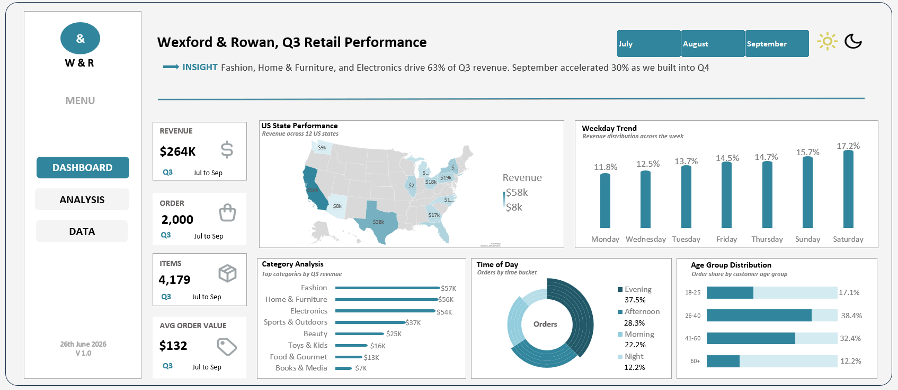
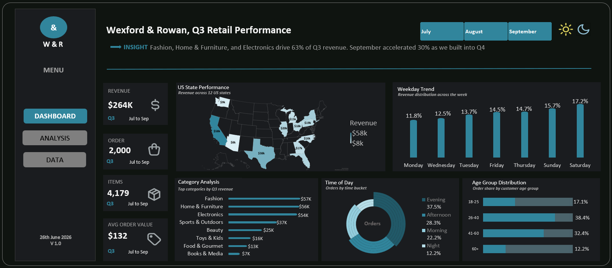

# 📊 Sales Performance Analysis – Wexford & Rowan (Q3)
Excel dashboard analysing Q3 sales, profit margins and customer behaviour
to help leadership plan for the Q4 holiday season.

## 🎯 Business Problem
Leadership didn't have a clear picture of what drove Q3 sales across categories, states and customer segments. 
They needed these insights to plan for the Q4 holiday season.

## 📁 Dataset
Rows, columns, time period, source.

## 🛠️ Tools
- Microsoft Excel (formulas, pivot tables, slicers)
- Google Sheets

## 🔍 Approach
1. Cleaned data (duplicates, blanks, inconsistent formats)
2. Built KPIs with pivot tables
3. Designed an interactive dashboard with slicers

## 📈 Key Insights
- **$264K** revenue from **2,000 orders**; September up **30%**
- Fashion, Home & Electronics drove **63%** of revenue
- California was the top state; Arizona the lowest
- Weekends and evenings (**37.5%**) were busiest
- Ages **26–40** placed the most orders (**38.4%**)

## ✅ Recommendations
- Boost stock and promotions for Fashion, Home & Electronics
- Increase marketing in California and Texas, and research why Arizona lags
- Add staff and promos on weekends and evenings, targeting ages 26–40

## 📝 Full Write-up
[Read the detailed analysis on Medium](https://medium.com/@georgietteansaah.tech/excel-project-wexford-rowan-q3-sales-performance-b995da545e8d)

## 🖼️ Light Mode

## 🖼️ Dark Mode

